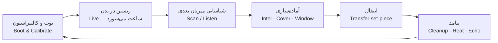

# ۵. مکانیک‌های اصلی (Core Mechanics) — 🟡 پیشنهاد

> این بخش مفهومِ A را (ر.ک. [۰۴](04-concepts.md)) به سیستم تبدیل می‌کند. همه‌چیز پیشنهاد است و برای تغییر آماده.

## ۵.۱ حلقهٔ اصلی



- **حلقهٔ کلان:** هر میزبان ≈ ۳۰–۹۰ دقیقه.
- **حلقهٔ خرد:** ثانیه‌به‌ثانیه، با قوانینِ همان بدن.
- **ریتم:** آرام (شناسایی) ← فشار (ساعت/تعقیب) ← **انفجار** (انتقال) ← **سکوت** (پیامد/پژواک). (درسِ Hotline Miami)

### بوت (Boot) — لحظهٔ امضا

هر انتقال با یک **قالبِ ثابت** شروع می‌شود، و داستان عمداً آن را در پرده‌ها می‌شکند (*قالب ← خرابکاری*):

1. **لاگ سیستم:** متنِ سرد روی سیاهی.
2. **هجومِ حس‌ها:** تصویرِ حسیِ اولیهٔ بدن.
3. **سیلِ خاطره (Memory Flood):** ۶۰–۱۲۰ ثانیه ویگنتِ بازی‌شدنی از *بهترین خاطرهٔ* میزبان (ر.ک. ۵.۶).
4. **کالیبراسیون:** یادگیریِ ورودی‌های بدن.
5. **آینه:** چهرهٔ میزبان.
6. **ساعت:** نگاه به مچ.

نمونهٔ لاگ:
```
> BOOT: SARA.OS v25
> host_viability ......... 124:15:33
> limbic_interference .... HIGH   (echo detected)
> motor_precision ........ 0.97
> WARNING: hormonal cycle unknown — forecast unavailable
```

**شکستنِ قالب:** جونز (فقط بحران، بدون کالیبراسیون)، توبی (`Loading… Child OS`، بدون نگاه به ساعت)، امیلی (لاگ حذف می‌شود، HUD خالی).

---

## ۵.۲ سیستم ۱ — ساعت (The Clock)

**قاعدهٔ پیشنهادی:** ساعت = **ذخیرهٔ میزبان ÷ بارِ متابولیکِ آیرا.**
یعنی *فکرکردن هزینه دارد*؛ هرچه آیرا بیشتر تحلیل/اورکلاک/جعل کند، بدن سریع‌تر خالی می‌شود. (تطبیق: ف۶ اورکلاک؛ ف۸ چیپ گلیکوژن کبد را می‌سوزاند.)

### منابعِ سوزش (Burn)

| منبع | اثر | نمونه از داستان |
|---|---|---|
| خونریزی/هورمون | سقوطِ ناگهانی | ف۵: 118 → 48 ساعت |
| اورکلاک | قدرتِ فوق‌العاده ← فروپاشی | ف۶: دلال |
| زخمِ مهلک | سقوطِ شدید | ف۱۰: ~120 ساعت ← 15 دقیقه |
| بارِ محاسباتی (تشخیص، جعل، تحلیل) | سوزشِ کند و دائم | ف۷–۸: اِما |
| تروما/ضربهٔ مغزی | کاهش | ف۱۴–۱۶ |
| طوفانِ پژواک (استرس) | افزایشِ کورتیزول ← سوزش | ف۳–۵، ۱۵ |

### منابعِ بازگشت (Refund) 🟡
غذا/گلوکز (دونات در ف۵، ۷)، خواب، دارو، آرام‌کردنِ پژواک. *هر بازگشت هزینه‌ای دارد* (زمان/ریسک).

### دو لایه
- **ساعتِ کمپین** (ساعت‌ها): بین صحنه‌ها و با رویدادهای زیستی.
- **ساعتِ صحنه** (دقیقه/ثانیه): ست‌پیس‌ها (ف۳: ۵ دقیقه؛ ف۱۰–۱۱: ۱۵ و ۸ دقیقه).

### بازنمایی
1. **ساعتِ فیزیکی روی مچ** (دیِجتیک).
2. **نشانه‌های بدنی:** رنگ‌پریدگی، رگ‌های سیاه (ف۳)، لرزش، لکه‌های خون در دید. (درسِ Sifu)
3. **صدا:** ضربان/نفس.
4. **نرخِ سوزش** (پیکان ↑↓) نه فقط مقدار — تا بازیکن بتواند برنامه بریزد.

### شکست
«خاموشیِ سیستم» ← **صفحهٔ کالبدشکافی از دید لوکاس** ← بازگشت به آخرین بوت (هر بوت = چک‌پوینت). (درسِ Dead Rising: سخاوت.)

---

## ۵.۳ سیستم ۲ — قانونِ بدن (Host Ruleset)

هر میزبان داده‌محور است — یک **کارت میزبان** ([۰۶](06-hosts.md)) با فیلدهای زیر:

| فیلد | مثال (مایک) |
|---|---|
| ساعتِ پایه + ضرایبِ سوزش | 136:45 · سوزش بالا در درگیری |
| فعل‌ها (Verbs) | دویدن، پرش، ضربه، گرفتن، رانندگی |
| فیلترِ ادراک | قرمزِ گرم، کنتراستِ بالا، ضربانِ بلند |
| جایگاهِ اجتماعی | ترساندن، تحسین |
| دانش | مسیرهای ورزشگاه، رانندگی |
| قیدها | نمی‌تواند ظریف کار کند |
| **عصیانِ سخت‌افزار** (Override) | پرخاشگری |
| پژواک | صدا، هدیه، بار، وتو |

- **بوتِ بدن / همگامی (Sync)** ۰–۱۰۰٪: با استفاده بالا می‌رود، با مقاومتِ پژواک پایین می‌آید؛ بر دقتِ کنترل و دسترسی به مهارت‌ها اثر می‌گذارد.
- **عصیانِ سخت‌افزار (Override Meter):** اگر پر شود، *بدن خودش عمل می‌کند* (مایک میز را می‌شکند؛ دلال پایپ می‌کشد؛ دستِ توبی از حرکت می‌ایستد). «بدن فرمان است»، ف۹.
- **قاعدهٔ طلایی:** *مهارتِ بدنی با بدن می‌میرد؛ دانش و ارزش‌ها به‌صورتِ پژواک می‌مانند.*

---

## ۵.۴ سیستم ۳ — انتقال (Transfer)

### الزامات
1. **تماسِ گردن** (C1).
2. **پنجره:** غفلت/ناتوانیِ هدف.
3. **پوشش:** شاهد/دوربین/نویز.
4. **انرژیِ چیپ:** ذخیرهٔ اضطراری (ف۶: دندان‌های جونز).
5. **میزبانِ مبدأ زنده و متحرک** (حتی یک حرکت—ف۱۱: «با آخرین برقِ ساکن در اعصاب»).

### فازها
**نزدیک‌شدن ← استخراج** (دردناک، پرسروصدا، هزینه‌بر) **← کاشت** (قفلِ سوزن‌ها) **← بوت.**

### بردارها — «قانون: هیچ دو انتقال یک‌شکل نیست»

| میزبانِ مبدأ ← مقصد | بردار | نوعِ بازی | فصل |
|---|---|---|---|
| آدام ← سارا | **خیانتِ صمیمیت** | زمان‌بندی/پنجره | ۳ |
| سارا ← دلال | **شکار** (اغواءِ نیمه‌کاره) | نزدیک‌شدن + ویران‌شدن | ۶ |
| دلال ← جونز | **فرار** در بیمارستانِ آشفته | مسیریابی زیر فشار | ۶ |
| جونز ← اِما | **طعمه/گاز** | تک‌دکمه، ۴ دقیقه | ۶ |
| اِما ← مایک | **اسپاتر** با پوششِ جمعیت | نزدیکی عمومی + زمان‌بندی | ۸ |
| مایک ← هکتور | **کمین/جسد** | مبارزهٔ ناامیدانه | ۱۱ |
| هکتور ← توبی | **پناهِ نیم‌دقیقه‌ای** | مخفی‌کاری | ۱۳ |
| توبی ← امیلی | **هکِ عاطفی** (دروغ + تله) | گفت‌وگو + محیط | ۱۴–۱۵ |
| امیلی ← خروج | **استخراجِ خود** | پایان | ۱۷ |

### کیفیتِ انتقال
- **پاک (Clean):** میزبانِ مبدأ بی‌سروصدا؛ پژواکِ نرم.
- **آشفته (Messy):** شاهد/خون/مدرک؛ پژواکِ سخت؛ Heat بالا.
- **شکست (Failed):** آسیب یا مرگ.
تابع: `Intel × Cover × زمانِ باقی‌مانده × Sync`.

### امضای زخم (Signature)
سوراخِ پشتِ گردن **امضای آیراست**؛ لوکاس در ف۱۳ آن را می‌یابد. راه‌های پنهان‌کردن: **گاز‌گرفتن** (ف۶)، زخمِ پوششی، حادثه. پنهان‌کردن هزینه دارد.

---

## ۵.۵ سیستم ۴ — شناسایی: «اسکن» در برابر «گوش‌دادن»

**قلبِ ستونِ ۲:** دو راهِ شناختنِ میزبان با نتیجه‌های متضاد.

| | **اسکن (Scan)** | **گوش‌دادن (Listen)** |
|---|---|---|
| حس | سرد و بالینی | انسانی و نزدیک |
| هزینه | کم؛ سریع | **زمان** و ریسکِ نزدیکی |
| می‌دهد | سلامت، دوام، رتبه («رد»، «ذخیره»، «برتر» — ف۸) | نام، ارزش‌ها، روال، **شعاعِ سوگ** (چه کسانی دلتنگش می‌شوند)، نقطهٔ ضعف |
| اثر بر انتقال | پایه | **بهتر** (اعتماد، پنجره) |
| اثر بر پژواک | نرم | **سنگین‌تر** (بقا قوی‌تر) |
| اثر بر HUD | سرد می‌ماند | کم‌کم انسانی می‌شود |

**ایده:** اسکن همیشه «منطقی» است؛ گوش‌دادن *تصمیمی* است. برخی گوش‌دادن‌ها **اجباری‌اند** (لمسِ ماریا، ف۱۳: «سیلِ خاطرات»). نزدیکی همیشه انتخاب نیست.

**شعاعِ سوگ (Grief Radius):** گرافی از آدم‌هایی که با میزبان گره دارند؛ هرچه گسترده‌تر، پژواک سنگین‌تر. (توبی: مادر. هکتور: ماریا، دیگو، سوفیا. مایک: خواهرِ پرستار، سگ.)

---

## ۵.۶ سیستم ۵ — پژواک و گروه‌کر (Echo & Choir)

**پژواک** بازماندهٔ لیمبیکِ میزبان است (ف۳: «سیناپس‌های فعال»). برای هر پژواک:

| ویژگی | معنا |
|---|---|
| **صدا** | شخصیت و لحن؛ کامنتِ دائم و مخالف‌خوانی |
| **فشار (Pressure)** | بالا می‌رود وقتی ارزش‌هایش نقض می‌شود |
| **پیوند (Bond)** | بالا می‌رود با گوش‌دادن/احترام |
| **هدیه (Gift)** | دانشِ قابل‌استفاده (ر.ک. ۰۶) |
| **بار (Burden)** | هزینه/محدودیتِ ماندگار |
| **وتو (Veto)** | در شرایطِ خاص، *بدن را قفل می‌کند* (توبی، ف۱۵) |

**رویدادِ عصیان:** فشارِ بالا ← لرزش، اشک، قفلِ دست، فلش‌بک، خرابیِ HUD.
**ابزار:** سرکوب (هزینهٔ ساعت/گرمایِ چیپ)، مذاکره (دیالوگ/دروغ)، گوش‌دادن (فشار کم؛ زمان‌بر).

**قاعدهٔ پیشنهادی ماندگاری:** *همهٔ پژواک‌ها می‌مانند.* با گذشتِ زمان خاموش‌تر می‌شوند مگر پیوندشان بالا باشد. (ف۹ و ف۱۱: اِما همچنان حاضر است.)

**سیلِ خاطره (Memory Flood):** در هر بوتِ جدید، ویگنتِ ۱–۲ دقیقه‌ای از *بهترین خاطرهٔ میزبان* بازی می‌شود. سارا: چند نتِ ویولن‌سل. مایک: ددلیفت. اِما: اولین رگ‌گیری. هکتور: رقصِ عروسی با ماریا. توبی: لگو. (درسِ Edith Finch.) *این هم هدیه است، هم گناه.*

**گروه‌کر:** در لحظاتِ تصمیم، صداها «رأی می‌دهند». آخرین صحنه یک **فوگِ باخ** است: همهٔ صداها هم‌زمان می‌خوانند و کم‌کم خاموش می‌شوند.

---

## ۵.۷ سیستم ۶ — موتور توجیه (Justification Engine)

به‌جای نوارِ اخلاق: **آیرا هر پرده داستانی می‌سازد تا خودش را قانع کند** (ر.ک. [۰۲](02-story-analysis.md) §۲.۶). بازیکن *توجیه* را انتخاب/فعال می‌کند.

| توجیه | سود | هدفِ معتبر | ترک (Crack) |
|---|---|---|---|
| **پاکسازی** (جراح) | فشارِ پژواکِ کمتر روی هدفِ «بد» | مجرمان | گوش‌دادن نشان می‌دهد او آدمِ پیچیده‌ای است |
| **مرحمت** (اتانازی) | فشارِ کمتر روی هدفِ در حال مرگ | مرگ قریب | او زندگی می‌خواست |
| **کارایی** | بهره‌وریِ تحلیل | هر هدف | حسِ انسانی از بین می‌رود (HUD سرد) |
| **قهرمان** | اعتمادِ اجتماعی، امتیازِ مثبت | بیمارستان | ساعت بدون پاداش می‌دود |
| **شکار** | قدرت/پرخاشگری | سالم و قوی | خانواده، دوستان |
| **بازی** | ریسک‌پذیری، دروغِ سریع | هر هدف | لوکاس نزدیک می‌شود |

- **ناهمخوانی (Dissonance):** استفادهٔ توجیه روی هدفِ نامعتبر ← جیغِ HUD، جهشِ فشارِ پژواک.
- **گوش‌دادن، توجیه را آزمون می‌کند** (مثلاً جونز واقعاً می‌خواست بمیرد؟).

---

## ۵.۸ سیستم ۷ — هواشناسیِ بدن (Biological Weather)

HUD پیش‌بینیِ «جبهه‌های» زیستی را نشان می‌دهد: **هورمونی، قند، آدرنال، خستگی.** هر میزبان اقلیمِ خودش را دارد.
- *بار اول ناشناخته است* (علامتِ ؟). قاعدگیِ سارا (ف۵) شوک است.
- بعد از آن می‌توان *پیش‌بینی* کرد (پژواکِ سارا درس می‌دهد: «به دنیای زن‌ها خوش آمدی»؛ هدیهٔ Triage اِما).
- هدف: انتخابِ برنامه‌ریزی‌شده («قبل از ظهر کار می‌کنم، قند را قبل از ۳ پر می‌کنم»).

---

## ۵.۹ سیستم ۸ — رابط به‌مثابهٔ ذهن (HUD as Psyche)

| لایه | حس | نمونه |
|---|---|---|
| **L0 بالینی** | سرد | درصدهای احتمال، برچسبِ تهدید، گراف ضربان |
| **L1 ترکیبی** | چهره‌ها | نام‌ها، چهره‌ها، رنگ‌ها |
| **L2 انسانی** | دست‌نوشته | علامت‌های دست‌خط، لکهٔ اشک، HUD تقریباً محو |

- **محرک:** گوش‌دادن، پیوندِ پژواک‌ها، ترک‌خوردنِ توجیه‌ها — *نه* یک نوارِ اخلاق.
- **معاوضه:** با L2 تحلیلِ سریع را از دست می‌دهی ولی مذاکره/پیوند به دست می‌آوری؛ با L0 قدرت و سرعت، تا زمانی که طوفانِ پژواک بیاید.
- **ترک‌خوردنِ رابط** صحنه‌های مهم را علامت‌گذاری می‌کند (لحظهٔ توبی: HUD برای اولین بار *جیغ* می‌زند).
- هر میزبان فیلترِ ادراکِ خودش را روی HUD می‌اندازد ([۰۸](08-visual-direction.md)).

---

## ۵.۱۰ سیستم ۹ — تعقیب و لوکاس (Heat)

**تابلوی مدارک (Evidence Board):** گره‌ها: امضا (سوراخ)، ساعت، رفتار/پروفایل، شاهدان، مکان‌ها. هر عملِ آیرا گره اضافه یا حذف می‌کند. فازهای لوکاس: **حدس ← الگو ← یقین (ف۱۳) ← تعقیب ← رویارویی.**

**ابزارهای بازیکن:**
- **نمودارِ دروغ (Alibi Graph):** هر جزئیاتِ اضافی یک گرهِ بالقوه ناهمخوان است؛ «دروغگوها جزئیات اضافه می‌کنند» (ف۱۲). بازجوییِ هکتور.
- **اطلاعاتِ غلط (Disinformation):** جملهٔ «من تازه شروع کردم» پروفایلِ لوکاس را به سمتِ «نقشهٔ بزرگ‌تر» می‌برد.
- **پاک‌سازی** (۵.۱۳).

**میان‌پردهٔ لوکاس:** ۵–۱۰ دقیقه پس از هر پرده، بازیکن در نقشِ لوکاس صحنه را بازسازی می‌کند — کم‌اکشن، سبک Obra Dinn — و **پیامد را از آن سو می‌بیند**: خانواده‌ها، جسد، سکوت. این **کنایهٔ نمایشی (Dramatic Irony)** است: بازیکن بیشتر از لوکاس می‌داند، و تماشای او دلهره می‌آورد. (ستون ۵.)

---

## ۵.۱۱ سیستم ۱۰ — ساعتِ مچی و حالتِ کوری

- **ساعت یک شیء است:** باید با بدن جابه‌جا شود (بندش را بستن، ف۷؛ اندازهٔ مچ‌ها متفاوت؛ در سطل‌زباله جا ماندن، ف۴). **و مدرک است** (ف۱۲: لوکاس مشکوک می‌شود؛ بهانهٔ «هدیهٔ پسرم» جان می‌دهد).
- **حالت کوری:** از ف۱۳ (جا‌ماندنِ ساعت روی جسدِ هکتور). HUD عددِ دقیق نمی‌دهد؛ **بازهٔ عدم‌قطعیت** (۴۰–۱۰۰ ساعت).
- **راهِ بازیابی:** *خواندنِ علائم* (رنگ‌پریدگی، نبض، لرزش) — هدیهٔ Triage اِما و پژواکِ جونز («حس مرگ») بازه را باریک می‌کند.
- **هدفِ ترس:** بدترین چیز، شکلِ ناشناخته‌بودن است نه عدد.

---

## ۵.۱۲ سیستم ۱۱ — نقاب و سوءظن (Persona & Suspicion)

سوءظن از **ناهماهنگیِ آیرا با بدن** می‌آید:

| منبع | نمونه |
|---|---|
| **گفتار ≠ ظاهر** | «حرف‌هات به قیافه‌ت نمی‌خوره» (ف۲) |
| **چشم‌ها** | «انگار هیچی پشتش نیست… و همه‌چیز هست» (ف۲)؛ لوکاس مردمک‌ها را می‌بیند (ف۱۲) |
| **شایستگیِ بیش‌ازحد** | اِما که ناگهان بی‌نقص است (ف۷) |
| **اکسسوری** | ساعتِ گران روی دستِ سرایدار (ف۱۲) |

**نقابِ اجتماعی** (چه کسی نامرئی است؟): سرایدارِ شب (هکتور) همه‌جا دسترسی دارد؛ پرستار اعتماد می‌گیرد؛ کودک مصون است؛ مایک می‌ترساند.

---

## ۵.۱۳ سیستم ۱۲ — پیامدِ فیزیکی: «بارِ اضافی» (Dead Weight)

پس از هر انتقال *جسد* می‌ماند. ف۴ یک ست‌پیسِ کامل از آن ساخته: کشیدنِ جسدِ ۷۰ کیلویی، پله‌ها، وایتکس، **رد خون زیر باران**، فراموش‌کردنِ ساعت.

- **کنترلِ وزنی:** جسد = کنترلِ سنگین (نه QWOP؛ فقط حسِ وزن).
- **رد:** باران آشکار می‌کند؛ وایتکس بو می‌دهد؛ دوربین می‌بیند.
- **رویکرد:** حسِ *کار و وحشت*، نه سرگرمی. ساعتِ فراموش‌شده = Heat + تأخیر.
- هکتور بهترین «پاک‌کننده» است (سرایدار!).

---

## ۵.۱۴ اولویت‌بندی برای برش عمودی

| سیستم | برش (P2) | حداقلِ بازی | کامل |
|---|---|---|---|
| ساعت (۵.۲) | ✅ | ✅ | ✅ |
| قانونِ بدن (۵.۳) | ✅ (۲ میزبان) | ✅ | ✅ |
| انتقال (۵.۴) | ✅ (۲ بردار) | ✅ | ✅ |
| اسکن/گوش‌دادن (۵.۵) | ✅ | ✅ | ✅ |
| پژواک/گروه‌کر (۵.۶) | ✅ (۲ صدا) | ✅ | ✅ |
| لوکاس/نمودار دروغ (۵.۱۰) | ✅ (بازجویی) | ✅ | ✅ + میان‌پرده |
| ساعتِ مچی/کوری (۵.۱۱) | ◐ ساعت | ✅ | ✅ |
| موتور توجیه (۵.۷) | — | ◐ | ✅ |
| HUD-ذهن (۵.۹) | ◐ L0 | ✅ | ✅ |
| هواشناسیِ بدن (۵.۸) | — | ◐ | ✅ |
| نقاب/سوءظن (۵.۱۲) | ◐ | ✅ | ✅ |
| بارِ اضافی (۵.۱۳) | — | ✅ | ✅ |

> قواعدِ نیازمندِ تصمیم (ساعت چه چیزی می‌سنجد؟ ماندگاریِ پژواک؟ مرگِ میزبان در استخراج؟) در [۰۹](09-open-questions.md).
